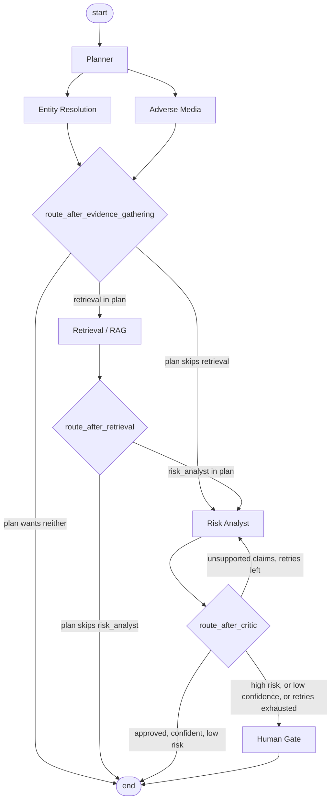

# Architecture

This describes the *target* design — what the finished system looks like.
Almost the entire codebase is currently scaffolding against this design, not
an implementation of it: see `PROJECT_PLAN.md` for the phase-by-phase
requirements that turn each piece from a placeholder into working code.

## Agent taxonomy used in this project

"Agent" is an overloaded word. This project deliberately uses several
*different kinds* of agent so the differences are visible in real code
instead of staying abstract.

| # | Agent | Type | Responsibility | Decides autonomously? |
|---|-------|------|-----------------|------------------------|
| 1 | Planner | Orchestrator | Turn the initial request into an ordered investigation plan; decide which downstream agents run | Yes — plan shape |
| 2 | Entity Resolution | Tool-using specialist | Match the entity name against public sanctions data; judge match confidence | Limited — accept/reject a match |
| 3 | Adverse Media | Tool-using specialist | Search the enforcement-notice corpus; judge relevance of hits | Limited — relevance filtering |
| 4 | Retrieval (RAG) | Tool-using specialist | Fetch and rank the regulatory passages relevant to the case | Limited — ranking, not content |
| 5 | Risk Analyst | Synthesis / reasoning | Combine all evidence into a structured, cited risk memo | Yes — the actual assessment |
| 6 | Critic | Evaluator / reflection | Check the memo against evidence; approve or send back for revision | Yes — approve/revise verdict |
| 7 | Router (conditional edges) | Control-flow | Three routers, each a pure function of state: `route_after_evidence_gathering` and `route_after_retrieval` decide whether Retrieval/Risk Analyst run at all (reading `state["plan"]`); `route_after_critic` decides revise / escalate / done | Yes — control flow |
| 8 | Human Gate | Human-in-the-loop | Pause execution for a human decision on high-risk/low-confidence cases | No — defers by design |
| 9 | Memory (checkpointer + case store) | Infrastructure | Persist working state and the durable case record | No — no judgment, just persistence |

Two things are worth noticing:

- **Not every "agent" makes decisions.** Entity Resolution and Retrieval are
  close to tools with a thin judgment layer; Planner, Risk Analyst, Critic,
  and the Router make real decisions. Treating all nine the same way (e.g.
  giving all of them an unrestricted LLM tool-calling loop) would be
  over-engineering for #2–4 and under-specifying for #1, #5, #6.
- **The Human Gate is an agent too.** In an agentic system in a regulated
  domain, "defer to a human" is a first-class, designed decision path, not
  an afterthought bolted on later.

## Graph shape ("design A": parallel evidence-gathering + plan-driven routing)

- **Entity Resolution and Adverse Media run as parallel branches**, not a
  fixed sequence — both read only `state["entity_name"]` and write disjoint
  state keys, so there's no data dependency between them (see design
  principle 1). This is a deliberate change from the original sequential
  design: see PROJECT_PLAN.md Phase 9 for the two conditional-edge routers
  this introduces, and why both branches can share one router function
  safely.
- **The Planner's `state["plan"]` now actually controls execution**, not
  just records intent. `route_after_evidence_gathering` and
  `route_after_retrieval` read `plan.steps` to decide whether Retrieval and
  Risk Analyst even run — a plan that omits a step genuinely skips it. A
  missing plan (`state["plan"] is None`) defaults to running everything,
  the same convention as `planner.build_static_plan`'s full step list.
  Entity Resolution and Adverse Media themselves are **not** plan-gated —
  they're reached by plain, unconditional edges and always both run; the
  plan only gates what happens after they join.
- The reflection loop (Risk Analyst ⇄ Critic) is still a **bounded** loop
  (`config.MAX_REVISIONS`) and is unaffected by the above — a critic
  "revise" verdict re-enters only at `risk_analyst`, never back through the
  parallel evidence-gathering branches. Reflection loops that aren't
  bounded are the most common way a demo turns into an incident.
- The **Human Gate is a genuine terminal-ish node**, not a formality: it's
  reached whenever the risk score clears a threshold, or the critic's own
  confidence is low, or retries are exhausted, and the graph only proceeds
  past it on a recorded human decision.

## Design principles (why this shouldn't contradict itself)

1. **One shared, typed state (`CaseState`), one direction of data flow.**
   Every node reads from and writes to the same `CaseState` object; no node
   reaches into another node's internals or keeps private state the rest of
   the system can't see. See `schemas.py` — given, read it before Phase 2.
2. **Tools are pure functions; nodes hold judgment.** `aml_agents/tools/`
   should contain no LLM calls and no state mutation — a tool takes
   arguments and returns data. `aml_agents/nodes/` holds the judgment layer
   that calls tools and decides what the results mean for the case. This
   separation is what makes Phase 2 (entity resolution) testable without
   any LLM at all.
3. **Every node has one job.** If you find yourself wanting the Risk
   Analyst to also decide whether to escalate to a human, that decision
   belongs in the Router/Critic, not the Risk Analyst — otherwise you get
   two agents that can disagree about the same decision with no way to
   reconcile them. (Concretely: `revision_count` is owned by
   `risk_analyst_node`, the approve/revise verdict by `critic_node`, and
   routing on both by `route_after_critic` — three single-purpose owners
   for one loop, not one function trying to do all three jobs. See
   PROJECT_PLAN.md Phases 7–9.)
4. **Bounded loops, everywhere.** The only cycle in the graph
   (Critic → Risk Analyst) has an explicit revision counter and a hard cap.
   The Entity Resolution / Adverse Media fan-out is parallel branching, not
   a cycle — each branch runs at most once per case, regardless of how many
   times the reflection loop fires. There are no other cycles.
5. **The LLM backend is a config detail, not an architectural one.**
   `llm_client.py` is the only file that knows whether you're calling the
   Anthropic API or a local model. No node should import a provider SDK
   directly — this is what lets you A/B a local model against the API on
   the same graph (PROJECT_PLAN.md Phase 13).

## Observability

Every node appends one `AgentTrace` entry to `CaseState["trace"]`
(node name, inputs summary, outputs summary, timing, and — for LLM-backed
nodes — token counts) via the given `make_trace()` helper. This is what
makes a seven-agent handoff debuggable: given a `case_id`, you can print the
full trace and see exactly which agent produced which claim, rather than
re-running the whole graph with print statements. See PROJECT_PLAN.md
Phase 12.

One consequence of the Entity Resolution / Adverse Media fan-out: their two
trace entries are no longer guaranteed to appear in a fixed order — whichever
branch's superstep finishes first appends first. This is safe (the `trace`
field's `operator.add` reducer merges concurrent appends correctly — verified
against a live run, not assumed) but means "read the trace top to bottom as
a strict timeline" is only reliable within each branch, not across the two
parallel ones. Each `AgentTrace` entry's own `timestamp` field still gives
you a true ordering if you need one.